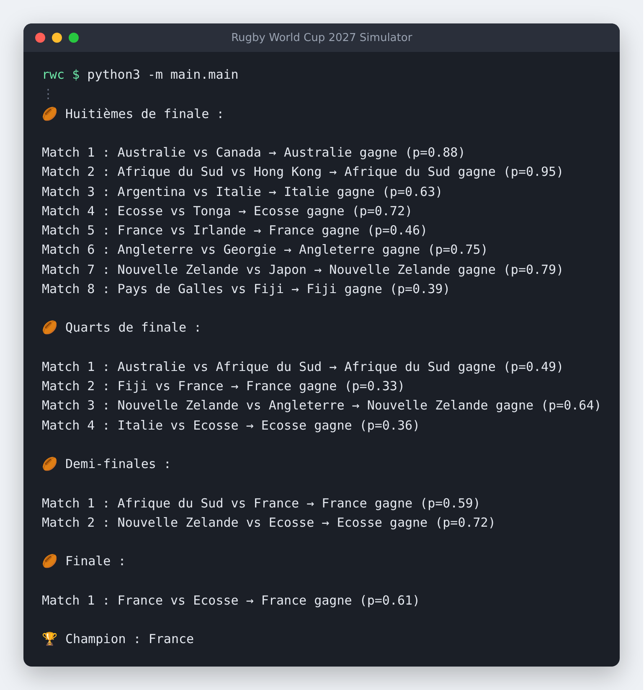
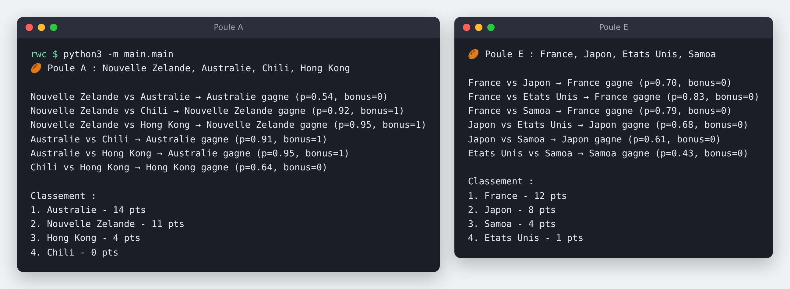
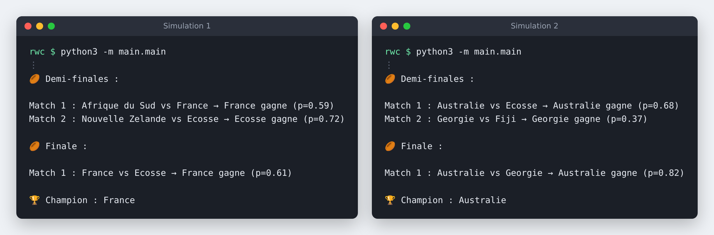

# Rugby World Cup 2027 Simulator

A Python simulator of the 2027 Rugby World Cup in Australia, from the pool stage to the final.
Each team's strength is an **ELO rating**, the rating system invented for chess, turned into a win probability for every match.

**Every run replays the whole tournament from scratch, so the champion can change from one simulation to the next.**



## Quick start

No library to install: only Python 3 and its standard library.

```bash
git clone https://github.com/Swimni/RWC-Simulator.git
cd RWC-Simulator/rwc
python3 -m main.main
```

## Reading the output

```
Argentina vs Italie → Italie gagne (p=0.63)
```

- **`p` is always the probability that the first team named (team A) wins**, computed before the match from the two ELO ratings. It is not the winner's probability.
- In this example, Argentina had a 63 % chance of winning and Italy 37 %, yet Italy won: an upset, which the random draw makes possible.
- In the pool stage, `bonus=1` means the winner also earned a bonus point.

## How it works

### 1. From ELO rating to win probability

Each of the 24 teams has an ELO rating in `data/teams.json`. The probability that team A beats team B is:

$$P(A) = \frac{1}{1 + 10^{(ELO_B - ELO_A)/400}}$$

For example, France (2000) against Japan (1850) gives France a **70 %** chance of winning.
This P(A) is the `p` printed next to every match.

### 2. Playing a match

| Win probability of A | Result |
| --- | --- |
| 85 % or more | A wins and earns a bonus point |
| 15 % or less | B wins and earns a bonus point |
| Between the two | Random draw weighted by the probability: an upset is always possible |

### 3. Pool stage

The 24 teams are split into 6 pools of 4, and every team plays the 3 others.

| Situation | Points |
| --- | --- |
| Win | 4 |
| Clear win (85 % favourite or more) | +1 bonus point |
| Close defeat (win probability between 42 % and 58 %) | 1 losing bonus point |

The top two of each pool and the **four best third-placed teams** go through to the round of 16, as in the real 2027 format.



### 4. Knockout stage

Round of 16 → quarter-finals → semi-finals → final. Each match is played with the same rules, until a champion is crowned.

## Design choices

- **ELO rather than Glicko-2**: ELO is simple, easy to explain and enough to compare teams. Glicko-2 adds a confidence measure on each rating, which this project does not need yet.
- **Home advantage**: Australia is the only host nation, so its home advantage is included directly in its base rating.
- **Bonus points**: real rugby awards them for scoring 4 tries or losing by 7 points or less. The simulator does not model the score, so it approximates them from the win probability.

## Same teams, different champion

Two runs of the simulator with exactly the same ratings: France wins the first one, Australia the second.



## Project structure

```
rwc/
├── assets/                 # screenshots used in this README
├── data/
│   ├── teams.json          # ELO rating of each team
│   └── pools.json          # the 6 pools
├── main/
│   └── main.py             # runs the whole tournament
└── simulation/
    ├── probabilities.py    # ELO → win probability
    ├── matches.py          # plays one match
    ├── pools.py            # pool stage and standings
    └── knockouts.py        # round of 16 → final
```

## Try your own scenarios

Change a rating in `data/teams.json` (for example, give Japan 2050) and run the simulator again to see how it changes the tournament.

## Next steps

- Run thousands of simulations in a row and show each team's chances of winning the title
- Update the ratings automatically from recent results